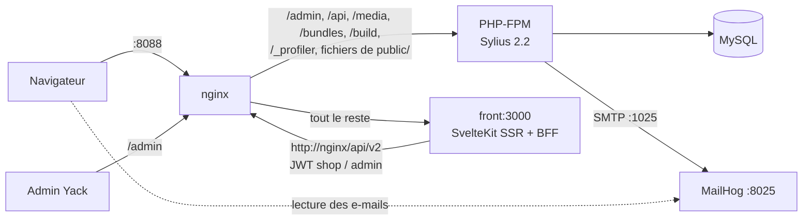

# POC Sylius — Yack (Clik&Yack)

Démonstrateur Sylius 2.2 / Symfony 7.4 pour Yack (génie climatique), en architecture **headless** :

- la boutique et le builder CMS sont une application **SvelteKit** (`front/`, Svelte 5, TypeScript strict, adapter-node), voir `front/README.md` ;
- **Sylius** ne sert plus que le back-office (`/admin`), l'API (`/api/v2`), les médias, les assets et les e-mails. L'ancienne boutique Twig est supprimée ;
- le contrat d'API consommé par le front est décrit dans `docs/API_FRONT.md`.

## Architecture



- Le navigateur ne parle qu'à nginx. Le front SvelteKit est un **BFF** : il appelle l'API Sylius côté serveur et garde les JWT dans des cookies `httpOnly` (`yack_session`, `yack_cart`, `yack_cms_token`). Aucun jeton n'est exposé au JavaScript, pas de CORS.
- Les règles métier restent dans Sylius : prix `null` et panier / commandes en 401 / 403 pour les visiteurs et les PRO (`CommerceAccessListener`, voir `docs/API_FRONT.md` §« Profils »), escompte, workflows, e-mails.
- Le back-office Sylius reste en Twig (grilles et hooks Yack : escompte, demandes d'ouverture, inscriptions PRO, menu *Contenu → Pages*).
- Les anciennes URL de la boutique Twig (`/fr_FR/…`) répondent par une **redirection 301** vers la route SvelteKit équivalente : accueil (nginx, un seul saut), fiches produit, catégories, panier, connexion, inscription, liens d'activation et de mot de passe, compte, SAV, installateurs (`front/src/lib/server/legacy.ts`). Une ancienne URL sans équivalent répond 404.

## Installation

```bash
bash data/yack/images/reel/telecharger.sh   # photos des produits (yack.fr), avant yack-reset : l'import ne remplace pas une image déjà posée
make yack-reset                 # base vierge, migrations, fixtures Yack, clés JWT, ICU fr_FR, assets, npm ci du front, MailHog vidé
make yack-up                    # socle + nginx + front (vite dev) sur http://localhost:8088, attend que la boutique réponde
FRONT_MODE=prod make yack-up    # idem avec le build de production du front (npm run build && node build)

# Démo de la synchro PIM/ERP (flux delta simulé)
make yack-sync                       # data/yack/api_feed_update.json
make yack-sync FEED=data/yack/catalog.json

# Recherche Meilisearch (facultative : sans elle, la boutique cherche en base)
echo 'YACK_SEARCH_ENGINE=meilisearch' >> .env.local
make yack-search-up                  # service meilisearch (profil « search » de compose.yml) et index
make yack-search-reindex             # reconstruit les index (synonymes et réglages compris)
```

- Port : `YACK_HTTP_PORT` (8088 par défaut, le port 80 étant souvent pris). `yack-reset` copie `compose.override.dist.yml` en `compose.override.yml` s'il manque (MailHog).
- `yack-reset` ne supprime pas les volumes Docker (médias, index Meilisearch) ; il recharge la base et les fixtures. Après un `yack-reset` avec Meilisearch actif : `make yack-search-reindex`.
- L'image `sylius-php:8.3-alpine` ne contient que les données ICU anglaises : `make yack-icu` (appelé par `yack-reset` et `yack-up`) installe celles du français pour le formatage des montants dans le back-office et les e-mails.
- La recherche n'exige pas le conteneur `meilisearch` : moteur absent ou arrêté, la boutique cherche en base et la mise à jour de l'index (synchronisation, fixtures) est journalisée puis ignorée (`var/log/yack_search.log`).

| Service | URL |
|---|---|
| Boutique (SvelteKit) | http://localhost:8088/ |
| Back-office Sylius | http://localhost:8088/admin/ |
| Builder CMS | http://localhost:8088/admin/yack/builder (connexion de l'admin, puis le builder) |
| Pages CMS publiques | http://localhost:8088/&lt;slug&gt; |
| Templates CMS (BO) | http://localhost:8088/admin/yack/contenu/templates |
| E-mails (MailHog) | http://localhost:8025 |

### Depuis un téléphone sur le Wi-Fi du Mac

Le téléphone et le Mac sur le même Wi-Fi ; la boutique tourne (`make yack-up`, avec ou sans `FRONT_MODE=prod`).

```bash
ipconfig getifaddr en0          # IP du Mac sur le Wi-Fi (essayer en1 si la ligne est vide), ex. 192.168.1.23
```

Sur le téléphone : `http://<IP du Mac>:<YACK_HTTP_PORT>/sav`, par exemple http://192.168.1.23:8090/sav (8088 si `YACK_HTTP_PORT` n'est pas fixé).

- Toujours l'IP, pas le nom `MonMac.local` : en `FRONT_MODE=dev`, le serveur Vite refuse un nom d'hôte qu'il ne connaît pas.
- Formulaires (connexion, panier, photo de la plaque) : le front n'a pas d'origine fixe, il la déduit de la requête (`PROTOCOL_HEADER` et en-tête `Host` transmis par nginx) ; le contrôle CSRF accepte donc l'IP du Mac comme `localhost`, sans réglage.
- Les URL de la boutique sont relatives (images, API, redirections) ; seuls les liens des e-mails (`FRONT_URL`, MailHog) pointent sur `localhost`.
- Si le téléphone n'obtient pas de réponse : pare-feu de macOS (Réglages Système, Réseau, Coupe-feu) à ouvrir pour Docker.

## Comptes

Mot de passe `yack` pour tous les comptes de fixtures.

| Profil | Identifiant | Prix | Panier / commande |
|---|---|---|---|
| Visiteur | — | masqués (« Connectez-vous pour voir les prix ») | non |
| PRO (groupe `pro`) | pro@yack.test, pro2@yack.test | masqués, incitation « Demander l'ouverture à la commande » (ou « Demande en cours ») | non (API 403) |
| ECOM (groupe `ecom`) | ecom@yack.test | visibles (HT) | oui |
| Admin (back-office + builder, `api: true`) | admin@yack.test | — | — |

Règle métier : l'inscription attribue le groupe `pro` ou `ecom` selon le profil choisi ; un client **sans groupe** est considéré ECOM. SIRET valides pour tester : `73282932000074` (TVA `FR44732829320`), `81234567800013`.

Après `make yack-reset`, la base ne contient **aucune commande** (numérotation à partir de `000000001`, rien de pré-payé ni de pré-expédié), 3 clients (pro, pro2, ecom), 2 pages CMS publiées (*Accueil*, *Nos services*) et 4 templates CMS publiés : fiche produit *Standard* (défaut) et *PAC premium* (catégorie PAC air/eau : bandeau, réassurance, FAQ en plus), page catégorie *Standard* (défaut) et *Pièces détachées* (racine Clik&Yack Parts).

## Numéros de série de démonstration

| N° de série | Modèles (ServiceCode) | Mise en service | Garantie (au 02/11/2026) |
|---|---|---|---|
| YK25EVO08M001234 | SC-EVO-M08 (PAC air/eau RHOSS-AIREAU-R32, 2 vues éclatées) | 10/04/2025 | pièces + compresseur sous garantie |
| YK19KAZ35S004567 | SC-KAZ-I35 + SC-KAZ-O35 (mural SRK25ZS-WFT + groupe extérieur SRC25ZS-W2) | 03/06/2019 | hors garantie |
| YK24HYD11S000321 | SC-HYD-I11 + SC-HYD-O11 (PAC air/eau split Hydrolution FDCW-VNX-A) | 21/02/2024 | pièces hors garantie, compresseur sous garantie |
| YK22THD200000789 | SC-THD-200 (ballon thermodynamique YORABTM200) | 08/11/2022 | compresseur sous garantie |

La saisie tolère la casse, les espaces, `-`, `_` et `.` (`yk19-kaz35s-004567` fonctionne). Un ServiceCode (`SC-KAZ-O35`) est aussi accepté.

### Plaques de démonstration (« La pièce par une photo », lecture pour les manuels)

Images FICTIF dans `public/yack/demo/plaques/` (régénérées par `php bin/yack-demo-plaques.php`, extension GD), téléchargeables depuis l'encart de `/sav` (« Plaques d'exemple pour la démonstration », les quatre premières lignes du tableau). Avec l'adapter de démonstration (`YACK_AI_ADAPTER=fake`), seules ces images sont lues, par un bloc texte qu'elles portent ; toute autre photo est « illisible ». La colonne « Lecture pour les manuels » donne la marque rendue par `POST /api/v2/shop/yack/assistance/plate-readings`, qui ne cherche rien (`docs/API_FRONT.md` §13).

| Fichier | Imprimé | `/sav` | Lecture pour les manuels |
|---|---|---|---|
| `plaque-YK24HYD11S000321-FICTIF.png` (et les trois autres numéros du tableau) | marque YACK, n° du parc, réf. FDCW-VNX-A | ouvre `/sav/YK24HYD11S000321` | marque `Yack` lue sur la plaque, même pour un appareil MHI (`plaque-YK19KAZ35S004567-FICTIF.png`, réf. SRK25ZS-WFT) |
| `plaque-SRK25ZS-W-FICTIF.png` | marque MHI, réf. SRK25ZS-W, n° MH21ZSW0004242 (absent du parc) | « Modèle reconnu dans le catalogue », lien vers la fiche SRK25ZS-W et noms de ses documents | marque `MHI` lue sur la plaque |
| `plaque-YK23EVO06M009999-FICTIF.png` | marque YACK, n° et réf. YK-PAE-M06 absents du parc et du catalogue | « Appareil non trouvé », lien contact | marque `Yack` lue sur la plaque |
| `plaque-illisible-FICTIF.png` | photo floue, sans bloc texte | « Plaque illisible : saisissez le numéro de série » | tous les champs à `null` |
| `plaque-sans-marque-FICTIF.png` | aucune marque, réf. SRK35ZS-W, n° MH22ZSW0003535 (absent du parc) | « Modèle reconnu dans le catalogue », fiche SRK35ZS-W | marque `MHI` déduite de la référence (`brandSource: deduite`) |

Sur le téléphone, avec l'adapter de démonstration : ouvrir l'encart, toucher une plaque d'exemple (le fichier va dans Fichiers, Téléchargements), puis « Choisir une image » et la prendre dans Fichiers. « Prendre une photo » ouvre l'appareil photo : une vraie photo n'est lue qu'avec l'adapter réel (section suivante), par exemple une plaque d'exemple affichée sur l'écran du Mac.

### Lecture réelle par un modèle (facultative)

Dans `.env.local` (jamais commité), l'un des deux blocs, puis `make yack-up` :

```bash
# Mistral (modèle qui lit les images)
YACK_AI_ADAPTER=mistral
YACK_AI_MODEL=mistral-small-2506
MISTRAL_API_KEY=<clé Mistral de Purjus>
MISTRAL_OCR_MODEL=<modèle OCR, pour les PDF seulement>
MISTRAL_BASE_URL=
YACK_AI_DAILY_CAP=200

# ou Anthropic
YACK_AI_ADAPTER=anthropic
YACK_AI_MODEL=<identifiant du modèle Claude choisi par Purjus>
ANTHROPIC_API_KEY=<clé Anthropic de Purjus>
YACK_AI_DAILY_CAP=200
```

La photo passe par `ExifStripper` (sans EXIF, 1 600 px au plus) puis par `LanguageModel` ; chaque appel compte dans le plafond quotidien (`YACK_AI_DAILY_CAP`, 200 si vide) ; au-delà, ou si le service ne répond pas en 20 s, l'encart affiche « Lecture indisponible : saisissez le numéro de série ». Le repère « · démonstration » disparaît des résultats. Contrôle avec la vraie clé : `docker compose exec php vendor/bin/phpunit --group external tests/Yack/AfterSales`.

Pièces détachées et vues éclatées fictives. Chaque modèle mène à la fiche de son produit fini réel (*Fiche produit*) : RHOSS-AIREAU-R32, SRK25ZS-WFT et SRC25ZS-W2, FDCW-VNX-A, YORABTM200.

## Moyens de paiement et escompte

| Moyen de paiement (code) | Escompte | Modalités |
|---|---|---|
| Virement sous 15 jours (`virement_15j`) | 2 % du HT | RIB fictif, référence `YACK-<n°>`, échéance J+15 |
| Carte bancaire (`carte_bancaire`) | 2 % du HT | page de paiement sécurisée simulée (Monext / Payline), 3-D Secure, aucun débit (ADR `docs/adr/0009-paiement-carte-prestataire-simule.md`) |
| Virement à échéance (`virement_echeance`) | aucun (prix normal) | RIB fictif, échéance J+30 |

- Taux : paramètre `app.yack.payment_method_escompte_rates` (`config/packages/yack.yaml`).
- `App\OrderProcessing\EscompteProcessor` (après les promotions, **avant les taxes**) répartit l'escompte sur les unités (ajustements `escompte`, base = articles HT hors port) : la **TVA est calculée sur le HT escompté**, port compris (TVA = 20 % du « Total HT »).
- Affichage : panier, tunnel, confirmation, e-mail, compte client, liste et fiche commande du back-office.

### Cartes de test (paiement carte simulé)

| Carte | Résultat |
|---|---|
| 4242 4242 4242 4242 (Visa) | acceptée |
| 5555 5555 5555 4444 (Mastercard) | acceptée |
| 4000 0000 0000 3220 (Visa) | 3-D Secure : code SMS `123456` accepté, tout autre code refusé |
| 4000 0000 0000 9995 (Visa) | refusée : fonds insuffisants |
| 4000 0000 0000 0002 (Visa) | refusée par la banque |

Expiration future quelconque, cryptogramme quelconque (3 chiffres). Le numéro complet ne quitte jamais la page `/paiement-securise/[session]` : Sylius ne reçoit que la marque, les 4 derniers chiffres et l'expiration.

Exemple de référence (après `make yack-reset`, compte ECOM) : groupe extérieur SRC80ZR-W (1 797,90 € HT) seul en virement 15 j → escompte −35,96 €, port 19,90 € HT, total HT 1 781,84 €, TVA 356,37 €, **2 138,21 €** TTC (commande `000000001`, panier vide ensuite).

## Script de démo (≈ 20 min)

Captures de référence : `/tmp/yack-demo/final-*.png` (régénérées à chaque passage).

1. **Accueil en visiteur** (http://localhost:8088/) : page CMS *Accueil* rendue en SSR (bandeau, gammes, incontournables, SAV, appel PRO), derniers produits, badge « Visiteur ». Menu : *Le groupe*, *Les marques*, *Nos documentations* (rubriques non cliquables, hors périmètre), *Nos services* (SAV, installateurs), *Nos produits → Clik&Yack / Clik&Yack Parts*, *Suivez vos commandes*.
2. **Catalogue** : `/produits` (produits finis) et `/pieces` (pièces détachées, 8 sous-familles) ; aucune carte n'affiche de prix. Fiche *SRC80ZR-W* (groupe extérieur Performance 8 kW) : attributs (modèle, typologie, secteurs), « Prix réservés aux clients connectés », pas de panier, template *Standard* ; le template *PAC premium* (bandeau, réassurance, FAQ autour du contenu standard) habille les fiches de la catégorie *Pompe à Chaleur Air/Eau* et `/pieces` suit le template *Pièces détachées* (appel SAV, familles, liste). Montrer une ancienne URL : `/fr_FR/taxons/nos-produits/clik-yack` → 301 `/produits`.
3. **Inscription PRO** (*Créer un compte*, `/inscription`) : profil PRO → société (SIRET faux `73282932000075` : « clé de contrôle incorrecte », puis `73282932000074` / `FR44732829320`) → contact → adresses (décocher « Livrer à cette adresse » pour une autre adresse de livraison) → « Votre compte est créé ».
4. **Activation** : MailHog → « Activez votre compte Clik&Yack » → lien `/activation/<token>` → « Votre compte est activé ». Se connecter (`/connexion`) : badge « Compte PRO », tableau de bord (société, SIRET, TVA, adresse). `/panier` explique que la commande est réservée aux comptes ECOM.
5. **Demande d'ouverture à la commande** (`/compte/acces-commande`) : formulaire pré-rempli (société, SIRET, contact, adresse), message libre → « demande envoyée ». Les fiches produits affichent « Demande d'ouverture à la commande en cours ».
6. **Back-office** (admin@yack.test, autre onglet) : tableau de bord → 1 demande en attente et la nouvelle inscription PRO. Fiche client → **Accepter** : le client passe ECOM, e-mail « Votre compte est ouvert à la commande » (MailHog). (Variante sans inscription : pro@yack.test / yack, ou pro2@.)
7. **Retour boutique** : badge « Compte ECOM », prix HT (SRC80ZR-W : 1 797,90 €, « En stock »). *Ajouter au panier*. Disponibilité binaire : « En stock » (commandable) ou « Rupture de stock » ; *Mural Titane Wifi intégré 2,5 kW* (SRK25ZS-WFT) est en rupture : prix affiché, pas de bouton panier, mention « Rupture de stock » (de nouveau en stock après la synchro de l'étape 13). Environ 80 % du catalogue est en stock (`data/yack/catalog.json`).
8. **SAV** (`/sav`) : `YK24HYD11S000321` → garantie simulée + 2 modèles → *module hydraulique intérieur* → vue éclatée : survol d'un repère = ligne surlignée (et inversement), prix et disponibilité. *Ajouter* la pièce n°5 (résistance d'appoint 139 €) : même panier que le groupe extérieur. La pièce n°4 (débitmètre) est en « Rupture de stock » : pas de bouton *Ajouter*.
   **La pièce par une photo** (encart sous la recherche ; sur téléphone, onglet *SAV* de la barre du bas) : *Choisir une image* `plaque-YK24HYD11S000321-FICTIF.png` → *Retrouver l'appareil* → même page que la saisie ; `plaque-SRK25ZS-W-FICTIF.png` → fiche du modèle MHI et ses documents ; `plaque-YK23EVO06M009999-FICTIF.png` → « Appareil non trouvé » ; `plaque-illisible-FICTIF.png` → « Plaque illisible ». Une photo de téléphone est réduite avant l'envoi (« réduite pour l'envoi » sous l'aperçu).
9. **Commande** : `/panier` → *Commander* → *Adresse* (carnet : livraison ZA Les Milles, facturation siège) → *Livraison* (transporteur 19,90 € HT ou retrait agence) → *Paiement* : **Virement sous 15 jours** → *Récapitulatif* (escompte, TVA, CGV, commentaire) → **confirmation avec RIB**, référence `YACK-000000001`, date limite ; e-mail « Confirmation de votre commande n° 000000001 ».
10. **Back-office → commande** : *Paiements* → **Terminer** (virement reçu), n° de suivi → **Livrer** : e-mail « Votre commande … a été expédiée ».
10 bis. **Paiement par carte** (compte ECOM, *Vanne 4 voies Evolys* YKP-V4V-EVO en stock) : *Paiement* → **Carte bancaire** → *Valider et payer* → page de paiement sécurisée (bandeau « Environnement de démonstration — aucun débit », marchand Yack, montant TTC, référence) :
    - 4242… → confirmation « Payé par carte Visa •••• 4242 », e-mail de confirmation (MailHog), back-office : paiement terminé, référence `SIM-…`, 3-D Secure non ;
    - 4000 0000 0000 3220 → écran 3-D Secure : `123456` → payée ; autre code → « Paiement non abouti » ;
    - 4000 0000 0000 0002 → « Paiement non abouti » → *Réessayer par carte* avec 4242 → payée ; ou *Payer par virement* (virement 15 j) → confirmation avec RIB, totaux recalculés, même commande ;
    - cocher « Enregistrer cette carte » : la commande suivante propose « Payer avec Visa •••• 4242 » (un clic, 3-D Secure si la carte le demande) ; *Mon compte → Mes cartes* liste et supprime les cartes.
    Une commande « Paiement carte en attente » se règle depuis *Mon compte → commande → Payer cette commande* ; le détail et le back-office montrent l'historique des tentatives.
11. **Client** : *Mon compte → Historique des commandes* : « Payée », « Expédiée » ; le détail affiche « Virement reçu », le n° de suivi, la ligne d'escompte et les totaux.
12. **Trouver un installateur** (`/trouver-un-installateur`) : 16 installateurs, filtres *Sud-Est + PAC air/eau + Dépannage* → **2 résultats** (Provence Clim Services, Vaucluse Thermique) sur la carte Leaflet.
13. **Synchro PIM/ERP** (terminal) : `make yack-sync` → 2 mis à jour (SRC80ZR-W à 1 699,90 €, SRK25ZS-WFT de nouveau en stock), 1 désactivé (RCN-KIT4-E2), 1 rejet (FDC100VSX-W, prix négatif), code retour 1 ; log JSON `var/log/yack_sync.log`. Rafraîchir la boutique : nouveau prix, SRK25ZS-WFT « En stock », produit désactivé en 404.
14. **Builder CMS** (back-office, *Contenu → Ouvrir le builder* ou http://localhost:8088/admin/yack/builder, admin@yack.test / yack : une seule connexion pour l'admin et le builder) :
    - *Nouvelle page* « Offre printemps PAC » → adresse `offre-printemps-pac` proposée → *Créer et ouvrir le builder* ;
    - panneau *Blocs Yack* : **glisser** *Bandeau principal* et *Produits mis en avant* dans le canevas, **cliquer** *Bandeau d'appel à l'action* (ajout en fin de page) ; le canevas charge la feuille de style de la boutique ;
    - sélectionner un bloc → propriétés dans *Bloc sélectionné* (titre, accroche, visuel parmi une liste, fond, bouton, codes produits `SRK20ZS-WFT, SRK25ZS-WFT, SRK25ZS-WF`…) ; ni gestionnaire de styles, ni bloc HTML, ni couleur libre ;
    - **Enregistrer en brouillon** (`/offre-printemps-pac` → 404 ; **Aperçu** avec bandeau « Aperçu du brouillon ») → **Publier** → *Voir la page* : produits mis en avant avec les prix si le visiteur est ECOM ;
    - mode *Mobile* : rendu responsive ;
    - onglet **Structure** (à gauche, à côté de *Blocs*) : arbre des blocs synchronisé avec le canevas ; glisser une ligne (ou Alt+↑ ↓) pour réordonner, Suppr / Ctrl+D, annuler / rétablir.
    - **Mise en page** (groupe *Mise en page* de la palette ; page de démonstration *Démo : mise en page*, `/demo-mise-en-page`) : glisser une *Section*, puis des *Colonnes* dans la section ; *Bloc* → répartition 66/33, alignement, espacement entre colonnes (espacements de la charte). Glisser une *FAQ* dans la colonne 1 et des *Cartes d'accompagnement* dans la colonne 2 ; un *Bandeau principal* lâché dans une colonne est refusé (bloc pleine largeur), une section dans une section aussi. *Structure* montre l'arbre (section › colonnes › colonne › bloc) : y glisser un bloc dans une colonne ou l'en sortir. Onglet *Style* de la section : fond, texte, espacements, largeur (normale ou pleine). **Publier** : la page publique reproduit le canevas ; en mode *Mobile*, les colonnes s'empilent. L'historique restaure une version imbriquée, *Enregistrer comme section* garde les conteneurs et leurs blocs ; un compte de niveau charte (editeur@yack.test) ne pose que des valeurs de la charte sur les conteneurs. L'API refuse (422, message en français qui nomme le chemin du bloc) une section dans une colonne, un bloc pleine largeur dans une colonne et 4 colonnes.
15. **Templates de pages communes** (barre du builder → *Templates*, ou *Contenu → Templates* du back-office) : *Fiches produit* (*Standard* par défaut, *PAC premium*) et *Pages catégorie* (*Standard*, *Pièces détachées*) :
    - ouvrir *PAC premium* : palette limitée aux blocs Yack + blocs produit ; le bloc *Achat* (obligatoire) porte un cadenas dans *Structure* et ne se supprime pas ; canevas = vraie fiche du produit d'aperçu, en-tête, fil d'Ariane, deux colonnes et pied de page compris, à la largeur d'un écran de 1440 px (*Template → Aperçu avec* pour choisir un autre produit) ; **Voir comme** *Visiteur* / *PRO* / *ECOM* (ECOM : prix et stock, sans appel panier) ;
    - *Structure* : sélectionner la *FAQ*, la remonter (Alt+↑), ajouter une question dans *Bloc* (« Question ? | Réponse ») ou supprimer le bloc *Réassurance* → **Publier** → les fiches de la catégorie *Pompe à Chaleur Air/Eau* l'affichent aussitôt (*Voir* = aperçu d'un brouillon, réservé à l'admin) ;
    - ouvrir *PAC premium* → *Affectations* → *Ajouter un produit* « Mural Titane », choisir SRK25ZS-WFT : la fiche passe en *PAC premium* ; le back-office (produit → onglet *Template CMS*) affiche la même affectation. Pour une catégorie : « pages produits » (fiches de ses produits) ≠ template de page catégorie ;
    - *Dupliquer* un template → copie en brouillon ouverte dans le builder.

### Script « Manuels et notices »

Module `/assistance` (`src/Yack/Assistance/README.md`), actif par défaut (`YACK_ASSISTANCE=1`), adapters de démonstration (rien dans `.env.local`). Résultats attendus relevés sur la base livrée (`data/yack/assistance`) en appelant les cas d'usage PHP avec ces adapters, parc et catalogue lus dans les fichiers du dépôt ; pas encore relevés sur la stack (Mac).

1. **Entrée** : `/sav` → lien « Trouver le manuel d'un appareil » sous l'encart photo (ou menu *Nos services → Manuels et notices* ; sur téléphone, onglet *SAV* : le lien est juste sous l'encart) → `/assistance` : barre « Référence, modèle ou n° de série », encart photo dessous.
2. **Référence** : saisir `srk25zs w` → compris `SRK25ZS-W`, marque MHI (catalogue), lien vers la fiche produit, bandeau « Documents de ce modèle » : 12 documents du modèle exact (dont 1 manuel de l'utilisateur en français, indexé pour les questions), puis 7 « même modèle, autre variante » et 5 « même série, pas de ce modèle exact ». *Ouvrir le PDF* ouvre le PDF officiel du fabricant dans un nouvel onglet.
3. **Série et nom** : `SRK25ZS` (sans suffixe) → « Documents de la même série » (19 documents, autre variante) ; `mural titane` → 8 modèles au choix (SRK15ZS-WFT à SRK50ZS-WFT) et « Précisez la puissance ou la référence pour affiner. » ; `mural titane 2,5` → 2 modèles (SRK25ZS-WFT, SRK25ZS-WT) ; `ZZZ` → « Aucun manuel trouvé » et lien contact.
4. **N° de série du parc** : `YK19KAZ35S004567` → produits du parc SRK25ZS-WFT et SRC25ZS-W2, 11 documents exacts, lien « Vues éclatées et garantie » vers `/sav/YK19KAZ35S004567`. Puis l'URL `/assistance?ref=SRK35ZS-W&sn=YK19KAZ35S004567` → bandeau « Le n° de série correspond à SRK25ZS-WFT, SRC25ZS-W2, la référence saisie est SRK35ZS-W : vérifiez la plaque. », les deux listes affichées.
5. **Photo** (encart, *Choisir une image*, plaques d'exemple de l'encart) : `plaque-SRK25ZS-W-FICTIF.png` → écran « C'est bien ça ? » : marque MHI et référence SRK25ZS-W « lue sur la plaque », n° MH21ZSW0004242, désignation « Mural 2,5 kW R32 » ; *C'est bien ça, voir les manuels* → résultats de SRK25ZS-W (`ref`, `sn` et `marque` dans l'URL, partageable), mêmes documents qu'à l'étape 2 (n° inconnu du parc, affiché seulement). `plaque-sans-marque-FICTIF.png` → SRK35ZS-W, marque MHI « déduite de la référence ». `plaque-illisible-FICTIF.png` → même écran, champs vides, « Plaque illisible : saisissez la référence ».
6. **Question** (résultats de `SRK25ZS-W`) : en visiteur, « Connectez-vous pour poser une question » ; connecté `pro@yack.test` / `yack`, réponses de démonstration (le meilleur passage mot pour mot, repère « démonstration ») :

   | Question | Source citée | Réponse |
   |---|---|---|
   | Comment nettoyer le filtre ? | manuel de l'utilisateur (français), p. 34 | « Ôtez le filtre photocatalytique désodorisant lavable (orange) du porte-filtre… » |
   | Le voyant RUN clignote, que faire ? | manuel de l'utilisateur, p. 10 | « Les voyants RUN clignotent rapidement lorsque le mode d'opération n'est pas valide. Page 35 » (renvoi du manuel imprimé, repris tel quel dans le texte indexé) |
   | Que signifie le code erreur E 16 ? | manuel technique (anglais), p. 82 | ligne du tableau d'autodiagnostic (« … Indoor fan \| … ON \| E16 \| … motor error \| … »), en anglais, avec l'avertissement « passage tiré d'un tableau » |
   | Quelle longueur de liaison maximale ? | manuel technique, p. 45 | tableau des limites d'usage (« Refrigerant line (one way) length \| Max. 20m \| Max. 25m »), avec l'avertissement |
   | Quelle est la capitale du Portugal ? | aucune | « Je ne trouve pas la réponse dans les manuels indexés de ce modèle. » |

   La source s'ouvre sur le PDF officiel à la page (`#page=N`, page 1 sur Safari iOS). Avec `FDC224KXZME1` (5 documents exacts, aucun indexé), pas de panneau : « Aucun manuel de ce modèle n’est encore indexé pour les questions. ».
7. **Coupure** (terminal) : `YACK_ASSISTANCE=0 make yack-up` → plus de lien sous l'encart photo de `/sav` ni d'entrée dans *Nos services*, la carte de `/fonctions-intelligentes` reste sans lien, `/assistance` répond 404 (avec ou sans recherche) et l'API aussi. `make yack-up` rétablit.

| Marche en mode démonstration (sans clé) | Demande une clé d'IA (`.env.local`, section « Lecture réelle par un modèle ») |
|---|---|
| Recherche par référence, nom ou n° de série, niveaux, liens vers les PDF officiels | Lecture d'une vraie photo de plaque (téléphone) : en démonstration, seules les plaques FICTIF sont lues, toute autre photo est « illisible » |
| Lecture des plaques FICTIF (bloc texte de l'image), écran « C'est bien ça ? » | Réponse rédigée en français à partir des passages lus (`YACK_AI_ADAPTER=mistral` ou `anthropic`) : en démonstration, le passage mot pour mot, en anglais pour le manuel technique |
| Questions : passages retrouvés, source et page, « je ne trouve pas », avertissement des tableaux | |

## Correspondance écrans ↔ cahier des charges

| Écran / démonstration | Section CDC couverte |
|---|---|
| *Nos produits → Clik&Yack / Clik&Yack Parts*, taxonomie multi-niveaux, attributs, marques | Catalogue produits finis et pièces détachées |
| Profils Visiteur / PRO / ECOM (prix et panier, règles portées par l'API) | Comptes clients, visibilité des prix |
| Inscription 4 étapes, activation par e-mail, mot de passe oublié, tableau de bord | Création de compte et espace client (§3.4) |
| Demande d'ouverture, BO *Demandes accès commande* et fiche client | Ouverture de compte à la commande (en attente / acceptée / refusée) |
| 3 moyens de paiement + « Escompte 2 % » (tunnel, confirmation, compte, BO) | Moyens de paiement, escompte |
| SAV : n° de série → modèles → vues éclatées → pièces (prix, stock, panier) ; garantie | Parcours SAV / pièces détachées, garantie |
| `app:yack:catalog:sync`, log `yack_sync` | Interface PIM/ERP |
| Trouver un installateur | Annuaire installateurs |
| Habillage Yack : design system de la maquette Figma de Quentin (primaire #A33C87, secondaire #82CEC8, tertiaire #F5EFB3, Lato, boutons et champs pilule) | Charte |
| *Contenu → Pages*, builder GrapesJS à blocs verrouillés, pages publiques SSR, accueil piloté par la page *Accueil* | Gestion de contenu / landing pages |
| *Contenu → Templates*, builder des templates (blocs liés, bloc obligatoire, affectations produit / catégorie) | Mise en page des fiches produit et pages catégorie |
| Habillage du back-office : maquette « Admin Sylius » du Figma (barre du haut, menu foncé, tableau de bord, cartes, tableaux, pastilles) | Charte |

*Les numéros de section du CDC ne figuraient pas dans le brief : correspondance à compléter par la production.*

## Organisation du code

### Sylius (`src/Yack/<Contexte>/{Domain,Application,Infrastructure}`)

- **Account** : `CustomerProfile` (Visitor / Pro / Ecom), `CommercePermission` (`YACK_SEE_PRICES`, `YACK_PLACE_ORDER`), `Siret` (SIRET + TVA). Inscription : ressource API + `RegisterCustomer` (client + utilisateur inactif + adresses, événement `sylius.customer.post_register` → e-mail d'activation). `CommerceAccessListener` ferme les ressources panier / commande de l'API aux non-ECOM ; `PriceHidingProductVariantNormalizer` met les prix à `null`. Demandes d'ouverture : entité `yack_order_access_request`, workflow, admin (`OrderAccessRequestAdminController`), e-mail `yack_order_access_granted`.
- **Catalog** : ports `ProductSource` (adapter `JsonFileProductSource`) et `ProductCatalog` (`SyliusProductCatalog`) ; message `SynchronizeCatalog` (Messenger) appelé par `app:yack:catalog:sync` et par la fixture `yack_catalog`.
- **AfterSales** : entités `src/Entity/AfterSales` (modèles, vues éclatées, repères, n° de série), ports `AfterSalesCatalog` (Doctrine) et `WarrantyProvider` (`FakeWarrantyProvider`), ressources API SAV. L'ajout d'une pièce au panier passe par l'API panier standard.
- **Installer** : port `InstallerDirectory`, adapter `InMemoryInstallerDirectory`, ressource API.
- **Payment** : escompte, modalités de virement (`PaymentInstructionExtension` pour les e-mails), paiement carte (port `CardPaymentGateway`, adapter `SimulatedMonextGateway`).
- **Content** : entité `CmsPage` (`blocks` JSON = source du rendu, `grapesData` = état de l'éditeur, statut brouillon / publié) ; `BlockType` (blocs libres ciblables par profil via la propriété `audience` : tous, visiteur, pro, ecom, connectés ; blocs liés aux templates) et `PageBlocks::normalize()` verrouillent la charte côté serveur (422 sinon) ; API `…/admin/cms-pages` (JWT admin) et `…/shop/cms-pages` (publiées seulement). Templates des pages communes : entité `CmsTemplate` (`type` product / taxon, un défaut publié par type), blocs liés au produit / à la catégorie (`BlockType::scope()`, bloc obligatoire unique `produit-achat` / `categorie-produits` vérifié par `PageBlocks`), affectations nullables `Product::$cmsTemplate`, `Taxon::$cmsTemplate` (page catégorie) et `Taxon::$productCmsTemplate` (fiches produit de la catégorie), résolution `CmsTemplateResolver` (produit > catégorie principale puis ancêtres > défaut ; catégorie > ancêtres > défaut), API `…/admin/cms-templates` (CRUD, `duplicate`, `assignments`) et `…/shop/cms-templates/resolve` (docs/API_FRONT.md § 11). Back-office : *Contenu → Templates* (liste, lien builder `/cms-admin/builder/templates/{id}`) et champ « Template CMS » des formulaires produit (onglet) et taxon, avec le template hérité affiché (`CmsTemplateChoices`, extensions de formulaire, hooks `config/packages/yack.yaml`). `CmsExtension` : liens du back-office vers le front, en chemins relatifs (`yack_cms_url()`, `yack_cms_builder_url()`, `yack_cms_template_builder_url()` ; le builder et les aperçus passent par `BuilderAccessController`, qui ouvre le builder avec la session admin) et template hérité (`yack_cms_template_inherited()`).
- **Backoffice** : habillage du back-office Sylius, côté PHP seulement les pictogrammes du menu (`AdminMenuIconListener`). Le reste est décrit dans « Habillage du back-office » ci-dessous.
- E-mails : gabarits `templates/shop/yack/email/`, déclarés via `sylius_mailer` dans `config/packages/yack.yaml` (`yack_front_url` pour les liens vers le front). La configuration de routage `sylius_shop` est conservée pour la sécurité (pare-feu shop), les liens « voir dans la boutique » de l'admin et Payum ; nginx n'envoie aucune de ces URL à PHP.

### Front (`front/`)

Routes, BFF, cookies et commandes : `front/README.md`. Données et mutations par remote functions SvelteKit (`front/src/lib/remote/*.remote.ts` : `query` / `form` / `command`, logique dans `front/src/lib/server/`) ; aucun `load` ni form action, sauf trois gardes de routage. Blocs CMS : `front/src/lib/blocks/` (miroir de `BlockType`, classes `.yack-cms-*`), blocs liés au produit / à la catégorie dans `blocks/bound/`, rendu d'un template par `TemplateView.svelte` ; builder (`lib/editor/`, arbre *Structure* dans `lib/editor/tree/`) ; style unique `assets/shop/styles/yack.scss` (tokens du design system de Quentin dans `_tokens.scss`, police Lato dans `assets/shop/fonts`, copiée par Encore), compilé par Encore (`/build/app/shop/app-shop-entry.css`) et chargé par la boutique, les pages publiques et le canevas du builder.

### Habillage du back-office

D'après la maquette « Admin Sylius » du Figma YACK Seduction (nœud 23:3, cadre de 1 920 px). Les **tokens sont ceux de la boutique** (`assets/shop/styles/_tokens.scss`, source unique) : aucune couleur, aucun rayon ni police en dur dans `assets/admin/styles/`.

| Où | Quoi |
|---|---|
| `assets/admin/styles/` | `yack.scss` (les `@use`), `_variables.scss` (mesures de la maquette : barre 80 px, menu 288 px, contenu 1 280 px), `_base.scss` (variables Tabler, Lato, boutons, champs), `_components.scss` (cartes, tableaux, pastilles, menus, pagination, onglets), `_layout.scss` (barre du haut, menu, titre de page), `_dashboard.scss` (tableau de bord) |
| `assets/admin/scripts/statistics-chart.js` | Graphique des ventes aux couleurs de la charte. Remplace le script de Sylius au build (`NormalModuleReplacementPlugin` dans `webpack.config.js`) : à recompiler avec la config `admin`, pas seulement `app.admin` |
| `assets/admin/scripts/sticky-header.js` | Le titre de page se colle sous la barre fixe du haut |
| `templates/admin/yack/` | Gabarits Yack : accès rapides, inscriptions PRO, lignes des actions en attente (`_pending_action`), logo, « Accéder au site » |
| `templates/bundles/SyliusAdminBundle/` | Surcharges de gabarits Sylius (en-tête de chaque fichier : ce qui change) : menu (page courante), tuiles de chiffres clés, carte des ventes, actions en attente, nouvelles commandes, logo des pages de connexion. **À relire à chaque montée de version de Sylius** |

Compiler après une modification (le build de l'admin ne prend que quelques secondes) :

```bash
docker compose run --rm nodejs "npx encore dev --config-name app.admin"
```

Ajouter `&& npx encore dev --config-name admin` après un changement du script du graphique. Pas de rechargement automatique : la surveillance de fichiers ne traverse pas le montage macOS.

**Fidèle à la maquette** : barre du haut, menu (pastille de la page courante, chevrons, pas de 32 px), titre, accès rapides, chiffres clés, carte des ventes (période, flèches, légende), actions en attente (pastille jaune s'il reste à traiter, grise à zéro), nouvelles commandes, inscriptions PRO. **Déduit des tokens** (la maquette ne montre que le tableau de bord) : grilles, formulaires, fiches, connexion, onglets, pagination, alertes. Sous 1 200 px, Tabler replie le menu en bandeau (logo sur pastille blanche) : seuls les couleurs et la typographie changent. **Pastilles** : turquoise = réussi ou disponible, jaune = à traiter, magenta 10 % = information, gris clair = neutre, orange d'accent (« Accents/Orange » du Figma) = rupture et erreur, la charte n'ayant pas de rouge ; le rouge reste pour les messages d'erreur de formulaire. Les textes secondaires sont en gris #9F9F9F comme sur la maquette (contraste faible sur blanc, à valider).

## Ce qui est réel / ce qui est simulé

| Réel (code réutilisable) | Simulé (adapters POC à remplacer) |
|---|---|
| Règle PRO / ECOM appliquée par l'API (prix `null`, 401 / 403 panier-commandes) | `JsonFileProductSource` lit `data/yack/*.json` au lieu de l'API PIM/ERP |
| Pipeline de synchro (création, mise à jour, désactivation, rejets, logs JSON, code retour) | `FakeWarrantyProvider` : dates déterministes par n° de série |
| Modèle SAV, parcours, panier unique PAC + pièces | Vues éclatées SVG dessinées pour la démo, images produits générées |
| Photo de la plaque : réduction dans le navigateur, contrôles, API, recherche au parc puis au catalogue, adapter réel (`LanguageModel`, EXIF retiré, plafond) | `FakeNameplateReader` : lit le bloc texte des plaques FICTIF, pas l'image |
| Panier, tunnel, commandes, back-office : Sylius natif via l'API | `InMemoryInstallerDirectory` : 16 installateurs fictifs |
| Escompte par moyen de paiement, TVA sur le HT escompté | Carte bancaire : `SimulatedMonextGateway` (page de paiement hébergée simulée, aucun débit) |
| Inscription (SIRET / TVA, activation e-mail), demandes d'ouverture, e-mails | RIB fictif ; SIRET contrôlé par sa clé (pas d'API Sirene) ; pas de notification à Yack ; e-mails capturés par MailHog |
| BFF SvelteKit (SSR, JWT en cookies `httpOnly`), redirections 301 des anciennes URL | Prix, stocks et EAN fictifs ; pièces détachées fictives, à la marque de l'appareil qu'elles servent (produits finis, catégories, marques et photos : catalogue public yack.fr) |
| Pages CMS : API, validation de la charte, builder (brouillon, aperçu, publication), rendu SSR | 6 visuels CMS fixes (`public/yack/cms`), pas de médiathèque |
| Templates CMS produit / catégorie : résolution, affectation (BO, API, builder), validation des blocs liés, rendu SSR | |
| Manuels et notices (`/assistance`) : correspondance référence → documents, liens vers les PDF officiels des fabricants, texte réel de pages choisies de trois manuels | Index tiré d'une recherche web des PDF publics (liens à contrôler) ; réponse aux questions extractive sans clé d'IA |

Brancher les vraies API Yack = écrire un adapter HTTP pour `ProductSource`, `WarrantyProvider` et `InstallerDirectory` ; domaines, API et front restent inchangés.

## Limites connues

- **Recherche** : Meilisearch seulement avec `YACK_SEARCH_ENGINE=meilisearch` (sinon recherche en base, sans fautes de frappe ni pertinence fine) ; la page `/recherche` trie par pertinence uniquement ; l'index ne suit que les changements passés par la synchronisation (une modification faite dans le back-office attend `make yack-search-reindex`).
- Templates : pas de suppression (dupliquer / renommer seulement) ; « Derniers produits » ne figure plus sur la fiche (le template décide du contenu) ; bloc *Documents* = images Sylius typées hors galerie (aucun document dans les données de démo) ; canevas : l'en-tête et le pied de page sont inertes (panier ECOM affiché à 0), les blocs produit d'une zone s'ordonnent dans leur colonne (un bloc ne passe d'une colonne à l'autre qu'en changeant de type).
- Back-office : le « Total » du résumé de commande est l'`itemsTotal` natif (TTC, escompte déduit, hors port) ; le total Yack est la ligne « Total TTC ». Les dates du back-office sont en UTC, celles du front en heure de Paris.
- Le plugin Mollie reste installé : menu admin « Subscriptions » et légende du graphique du tableau de bord en anglais.
- Pages CMS et templates : une seule version (sur une page en ligne, « Retirer du site » la repasse en brouillon après confirmation), pas d'historique ; session du builder limitée à la durée du JWT (1 h) ; le `grapesData` d'une page CMS est rechargé tel quel s'il existe (un template est reconstruit depuis ses blocs) ; dans le canevas, les liens sont inactifs ; « Ordinateur » = 1440 px réduits par zoom (texte plus petit qu'à l'écran sur un petit moniteur).
- Non portés depuis l'ancienne boutique Twig : avis produits, liste de souhaits, sélecteur de langue (FR seul).
- *Le groupe*, *Nos marques*, *Catalogues* et *Documentation* sont des pages CMS de démonstration (textes FICTIF à remplacer par ceux de Yack) ; les anciennes URL de marques (`/fr_FR/taxons/marques/…`) répondent 404.
