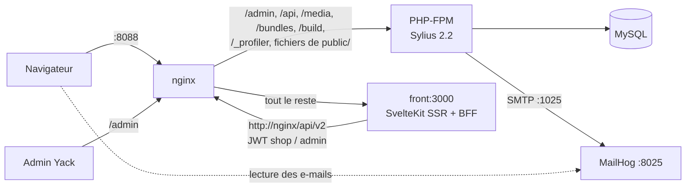

# POC Sylius — Yack (Clik&Yack)

Démonstrateur Sylius 2.2 / Symfony 7.4 pour Yack (génie climatique), en architecture **headless** :

- la boutique et le builder CMS sont une application **SvelteKit** (`front/`, Svelte 5, TypeScript strict, adapter-node), voir `front/README.md` ;
- **Sylius** ne sert plus que le back-office (`/admin`), l'API (`/api/v2`), les médias, les assets et les e-mails. L'ancienne boutique Twig est supprimée ;
- le contrat d'API consommé par le front est décrit dans `docs/API_FRONT.md`.

## Architecture



- Le navigateur ne parle qu'à nginx. Le front SvelteKit est un **BFF** : il appelle l'API Sylius côté serveur et garde les JWT dans des cookies `httpOnly` (`yack_session`, `yack_cart`, `yack_cms_token`). Aucun jeton n'est exposé au JavaScript, pas de CORS.
- Les règles métier restent dans Sylius : prix `null` et panier / commandes en 401 / 403 pour les visiteurs et les PRO (`CommerceAccessListener`, voir `docs/API_FRONT.md` §« Profils »), escompte, workflows, e-mails.
- Le back-office Sylius reste en Twig (grilles et hooks Yack : escompte, demandes d'ouverture, inscriptions PRO, menu *Contenu → Pages*).
- Les anciennes URL de la boutique Twig (`/fr_FR/…`) répondent par une **redirection 301** vers la route SvelteKit équivalente : accueil (nginx, un seul saut), fiches produit, catégories, panier, connexion, inscription, liens d'activation et de mot de passe, compte, SAV, installateurs (`front/src/lib/server/legacy.ts`). Une ancienne URL sans équivalent répond 404.

## Installation

```bash
bash data/yack/images/reel/telecharger.sh   # photos des produits (yack.fr), avant yack-reset : l'import ne remplace pas une image déjà posée
make yack-reset                 # base vierge, migrations, fixtures Yack, clés JWT, ICU fr_FR, assets, npm ci du front, MailHog vidé
make yack-up                    # socle + nginx + front (vite dev) sur http://localhost:8088, attend que la boutique réponde
FRONT_MODE=prod make yack-up    # idem avec le build de production du front (npm run build && node build)

# Démo de la synchro PIM/ERP (flux delta simulé)
make yack-sync                       # data/yack/api_feed_update.json
make yack-sync FEED=data/yack/catalog.json

# Recherche Meilisearch (facultative : sans elle, la boutique cherche en base)
echo 'YACK_SEARCH_ENGINE=meilisearch' >> .env.local
make yack-search-up                  # service meilisearch (profil « search » de compose.yml) et index
make yack-search-reindex             # reconstruit les index (synonymes et réglages compris)
```

- Port : `YACK_HTTP_PORT` (8088 par défaut, le port 80 étant souvent pris). `yack-reset` copie `compose.override.dist.yml` en `compose.override.yml` s'il manque (MailHog).
- `yack-reset` ne supprime pas les volumes Docker (médias, index Meilisearch) ; il recharge la base et les fixtures. Après un `yack-reset` avec Meilisearch actif : `make yack-search-reindex`.
- L'image `sylius-php:8.3-alpine` ne contient que les données ICU anglaises : `make yack-icu` (appelé par `yack-reset` et `yack-up`) installe celles du français pour le formatage des montants dans le back-office et les e-mails.
- La recherche n'exige pas le conteneur `meilisearch` : moteur absent ou arrêté, la boutique cherche en base et la mise à jour de l'index (synchronisation, fixtures) est journalisée puis ignorée (`var/log/yack_search.log`).

| Service | URL |
|---|---|
| Boutique (SvelteKit) | http://localhost:8088/ |
| Back-office Sylius | http://localhost:8088/admin/ |
| Builder CMS | http://localhost:8088/cms-admin/builder |
| Pages CMS publiques | http://localhost:8088/&lt;slug&gt; |
| Templates CMS (BO) | http://localhost:8088/admin/yack/contenu/templates |
| E-mails (MailHog) | http://localhost:8025 |

## Comptes

Mot de passe `yack` pour tous les comptes de fixtures.

| Profil | Identifiant | Prix | Panier / commande |
|---|---|---|---|
| Visiteur | — | masqués (« Connectez-vous pour voir les prix ») | non |
| PRO (groupe `pro`) | pro@yack.test, pro2@yack.test | masqués, incitation « Demander l'ouverture à la commande » (ou « Demande en cours ») | non (API 403) |
| ECOM (groupe `ecom`) | ecom@yack.test | visibles (HT) | oui |
| Admin (back-office + builder, `api: true`) | admin@yack.test | — | — |

Règle métier : l'inscription attribue le groupe `pro` ou `ecom` selon le profil choisi ; un client **sans groupe** est considéré ECOM. SIRET valides pour tester : `73282932000074` (TVA `FR44732829320`), `81234567800013`.

Après `make yack-reset`, la base ne contient **aucune commande** (numérotation à partir de `000000001`, rien de pré-payé ni de pré-expédié), 3 clients (pro, pro2, ecom), 2 pages CMS publiées (*Accueil*, *Nos services*) et 4 templates CMS publiés : fiche produit *Standard* (défaut) et *PAC premium* (catégorie PAC air/eau : bandeau, réassurance, FAQ en plus), page catégorie *Standard* (défaut) et *Pièces détachées* (racine Clik&Yack Parts).

## Numéros de série de démonstration

| N° de série | Modèles (ServiceCode) | Mise en service | Garantie (au 02/11/2026) |
|---|---|---|---|
| YK25EVO08M001234 | SC-EVO-M08 (PAC air/eau RHOSS-AIREAU-R32, 2 vues éclatées) | 10/04/2025 | pièces + compresseur sous garantie |
| YK19KAZ35S004567 | SC-KAZ-I35 + SC-KAZ-O35 (mural SRK25ZS-WFT + groupe extérieur SRC25ZS-W2) | 03/06/2019 | hors garantie |
| YK24HYD11S000321 | SC-HYD-I11 + SC-HYD-O11 (PAC air/eau split Hydrolution FDCW-VNX-A) | 21/02/2024 | pièces hors garantie, compresseur sous garantie |
| YK22THD200000789 | SC-THD-200 (ballon thermodynamique YORABTM200) | 08/11/2022 | compresseur sous garantie |

La saisie tolère la casse, les espaces, `-`, `_` et `.` (`yk19-kaz35s-004567` fonctionne). Un ServiceCode (`SC-KAZ-O35`) est aussi accepté.

Pièces détachées et vues éclatées fictives. Chaque modèle mène à la fiche de son produit fini réel (*Fiche produit*) : RHOSS-AIREAU-R32, SRK25ZS-WFT et SRC25ZS-W2, FDCW-VNX-A, YORABTM200 ; les deux PAC air/eau (RHOSS-AIREAU-R32, FDCW-VNX-A, trois modèles SAV) ne sont pas commercialisées en ligne.

## Moyens de paiement et escompte

| Moyen de paiement (code) | Escompte | Modalités |
|---|---|---|
| Virement sous 15 jours (`virement_15j`) | 2 % du HT | RIB fictif, référence `YACK-<n°>`, échéance J+15 |
| Carte bancaire (`carte_bancaire`) | 2 % du HT | passerelle *offline* : paiement marqué payé, aucun débit |
| Virement à échéance (`virement_echeance`) | aucun (prix normal) | RIB fictif, échéance J+30 |

- Taux : paramètre `app.yack.payment_method_escompte_rates` (`config/packages/yack.yaml`).
- `App\OrderProcessing\EscompteProcessor` (après les promotions, **avant les taxes**) répartit l'escompte sur les unités (ajustements `escompte`, base = articles HT hors port) : la **TVA est calculée sur le HT escompté**, port compris (TVA = 20 % du « Total HT »).
- Affichage : panier, tunnel, confirmation, e-mail, compte client, liste et fiche commande du back-office.

Exemple de référence (après `make yack-reset`, compte ECOM) : groupe extérieur SRC80ZR-W (1 797,90 € HT) seul en virement 15 j → escompte −35,96 €, port 19,90 € HT, total HT 1 781,84 €, TVA 356,37 €, **2 138,21 €** TTC (commande `000000001`, panier vide ensuite).

## Script de démo (≈ 20 min)

Captures de référence : `/tmp/yack-demo/final-*.png` (régénérées à chaque passage).

1. **Accueil en visiteur** (http://localhost:8088/) : page CMS *Accueil* rendue en SSR (bandeau, gammes, incontournables, SAV, appel PRO), derniers produits, badge « Visiteur ». Menu : *Le groupe*, *Les marques*, *Nos documentations* (rubriques non cliquables, hors périmètre), *Nos services* (SAV, installateurs), *Nos produits → Clik&Yack / Clik&Yack Parts*, *Suivez vos commandes*.
2. **Catalogue** : `/produits` (produits finis) et `/pieces` (pièces détachées, 8 sous-familles) ; aucune carte n'affiche de prix. Fiche *SRC80ZR-W* (groupe extérieur Performance 8 kW) : attributs (modèle, typologie, secteurs, commercialisé en ligne), « Prix réservés aux clients connectés », pas de panier, template *Standard* ; le template *PAC premium* (bandeau, réassurance, FAQ autour du contenu standard) habille les fiches de la catégorie *Pompe à Chaleur Air/Eau* et `/pieces` suit le template *Pièces détachées* (appel SAV, familles, liste). Un produit non commercialisé en ligne affiche « Non commercialisé en ligne » à tous les profils, sans prix ni panier. Montrer une ancienne URL : `/fr_FR/taxons/nos-produits/clik-yack` → 301 `/produits`.
3. **Inscription PRO** (*Créer un compte*, `/inscription`) : profil PRO → société (SIRET faux `73282932000075` : « clé de contrôle incorrecte », puis `73282932000074` / `FR44732829320`) → contact → adresses (décocher « Livrer à cette adresse » pour une autre adresse de livraison) → « Votre compte est créé ».
4. **Activation** : MailHog → « Activez votre compte Clik&Yack » → lien `/activation/<token>` → « Votre compte est activé ». Se connecter (`/connexion`) : badge « Compte PRO », tableau de bord (société, SIRET, TVA, adresse). `/panier` explique que la commande est réservée aux comptes ECOM.
5. **Demande d'ouverture à la commande** (`/compte/acces-commande`) : formulaire pré-rempli (société, SIRET, contact, adresse), message libre → « demande envoyée ». Les fiches produits affichent « Demande d'ouverture à la commande en cours ».
6. **Back-office** (admin@yack.test, autre onglet) : tableau de bord → 1 demande en attente et la nouvelle inscription PRO. Fiche client → **Accepter** : le client passe ECOM, e-mail « Votre compte est ouvert à la commande » (MailHog). (Variante sans inscription : pro@yack.test / yack, ou pro2@.)
7. **Retour boutique** : badge « Compte ECOM », prix HT (SRC80ZR-W : 1 797,90 €). *Ajouter au panier*.
8. **SAV** (`/sav`) : `YK24HYD11S000321` → garantie simulée + 2 modèles → *module hydraulique intérieur* → vue éclatée : survol d'un repère = ligne surlignée (et inversement), prix et stock. *Ajouter* la pièce n°5 (résistance d'appoint 139 €) : même panier que le groupe extérieur.
9. **Commande** : `/panier` → *Commander* → *Adresse* (carnet : livraison ZA Les Milles, facturation siège) → *Livraison* (transporteur 19,90 € HT ou retrait agence) → *Paiement* : **Virement sous 15 jours** → *Récapitulatif* (escompte, TVA, CGV, commentaire) → **confirmation avec RIB**, référence `YACK-000000001`, date limite ; e-mail « Confirmation de votre commande n° 000000001 ».
10. **Back-office → commande** : *Paiements* → **Terminer** (virement reçu), n° de suivi → **Livrer** : e-mail « Votre commande … a été expédiée ».
11. **Client** : *Mon compte → Historique des commandes* : « Payée », « Expédiée » ; le détail affiche « Virement reçu », le n° de suivi, la ligne d'escompte et les totaux.
12. **Trouver un installateur** (`/trouver-un-installateur`) : 16 installateurs, filtres *Sud-Est + PAC air/eau + Dépannage* → **2 résultats** (Provence Clim Services, Vaucluse Thermique) sur la carte Leaflet.
13. **Synchro PIM/ERP** (terminal) : `make yack-sync` → 2 mis à jour (SRC80ZR-W à 1 699,90 €, SRK25ZS-WFT de nouveau en stock), 1 désactivé (RCN-KIT4-E2), 1 rejet (FDC100VSX-W, prix négatif), code retour 1 ; log JSON `var/log/yack_sync.log`. Rafraîchir la boutique : nouveau prix, SRK25ZS-WFT « En stock », produit désactivé en 404.
14. **Builder CMS** (http://localhost:8088/cms-admin/builder, admin@yack.test / yack ; aussi via *Contenu → Pages* du back-office) :
    - *Nouvelle page* « Offre printemps PAC » → adresse `offre-printemps-pac` proposée → *Créer et ouvrir le builder* ;
    - panneau *Blocs Yack* : **glisser** *Bandeau principal* et *Produits mis en avant* dans le canevas, **cliquer** *Bandeau d'appel à l'action* (ajout en fin de page) ; le canevas charge la feuille de style de la boutique ;
    - sélectionner un bloc → propriétés dans *Bloc sélectionné* (titre, accroche, visuel parmi une liste, fond, bouton, codes produits `SRK20ZS-WFT, SRK25ZS-WFT, SRK25ZS-WF`…) ; ni gestionnaire de styles, ni bloc HTML, ni couleur libre ;
    - **Enregistrer en brouillon** (`/offre-printemps-pac` → 404 ; **Aperçu** avec bandeau « Aperçu du brouillon ») → **Publier** → *Voir la page* : produits mis en avant avec les prix si le visiteur est ECOM ;
    - mode *Mobile* : rendu responsive ;
    - onglet **Structure** (à gauche, à côté de *Blocs*) : arbre des blocs synchronisé avec le canevas ; glisser une ligne (ou Alt+↑ ↓) pour réordonner, Suppr / Ctrl+D, annuler / rétablir.
15. **Templates de pages communes** (barre du builder → *Templates*, ou *Contenu → Templates* du back-office) : *Fiches produit* (*Standard* par défaut, *PAC premium*) et *Pages catégorie* (*Standard*, *Pièces détachées*) :
    - ouvrir *PAC premium* : palette limitée aux blocs Yack + blocs produit ; le bloc *Achat* (obligatoire) porte un cadenas dans *Structure* et ne se supprime pas ; canevas = vraie fiche du produit d'aperçu (*Template → Aperçu avec* pour en choisir un autre) ;
    - *Structure* : sélectionner la *FAQ*, la remonter (Alt+↑), ajouter une question dans *Bloc* (« Question ? | Réponse ») ou supprimer le bloc *Réassurance* → **Publier** → les fiches de la catégorie *Pompe à Chaleur Air/Eau* l'affichent aussitôt (*Voir* = aperçu d'un brouillon, réservé à l'admin) ;
    - ouvrir *PAC premium* → *Affectations* → *Ajouter un produit* « Mural Titane », choisir SRK25ZS-WFT : la fiche passe en *PAC premium* ; le back-office (produit → onglet *Template CMS*) affiche la même affectation. Pour une catégorie : « pages produits » (fiches de ses produits) ≠ template de page catégorie ;
    - *Dupliquer* un template → copie en brouillon ouverte dans le builder.

## Correspondance écrans ↔ cahier des charges

| Écran / démonstration | Section CDC couverte |
|---|---|
| *Nos produits → Clik&Yack / Clik&Yack Parts*, taxonomie multi-niveaux, attributs, marques | Catalogue produits finis et pièces détachées |
| Profils Visiteur / PRO / ECOM (prix et panier, règles portées par l'API) | Comptes clients, visibilité des prix |
| Inscription 4 étapes, activation par e-mail, mot de passe oublié, tableau de bord | Création de compte et espace client (§3.4) |
| Demande d'ouverture, BO *Demandes accès commande* et fiche client | Ouverture de compte à la commande (en attente / acceptée / refusée) |
| 3 moyens de paiement + « Escompte 2 % » (tunnel, confirmation, compte, BO) | Moyens de paiement, escompte |
| SAV : n° de série → modèles → vues éclatées → pièces (prix, stock, panier) ; garantie | Parcours SAV / pièces détachées, garantie |
| `app:yack:catalog:sync`, log `yack_sync` | Interface PIM/ERP |
| Trouver un installateur | Annuaire installateurs |
| Habillage Yack : design system de la maquette Figma de Quentin (primaire #A33C87, secondaire #82CEC8, tertiaire #F5EFB3, Lato, boutons et champs pilule) | Charte |
| *Contenu → Pages*, builder GrapesJS à blocs verrouillés, pages publiques SSR, accueil piloté par la page *Accueil* | Gestion de contenu / landing pages |
| *Contenu → Templates*, builder des templates (blocs liés, bloc obligatoire, affectations produit / catégorie) | Mise en page des fiches produit et pages catégorie |

*Les numéros de section du CDC ne figuraient pas dans le brief : correspondance à compléter par la production.*

## Organisation du code

### Sylius (`src/Yack/<Contexte>/{Domain,Application,Infrastructure}`)

- **Account** : `CustomerProfile` (Visitor / Pro / Ecom), `CommercePermission` (`YACK_SEE_PRICES`, `YACK_PLACE_ORDER`), `Siret` (SIRET + TVA). Inscription : ressource API + `RegisterCustomer` (client + utilisateur inactif + adresses, événement `sylius.customer.post_register` → e-mail d'activation). `CommerceAccessListener` ferme les ressources panier / commande de l'API aux non-ECOM ; `PriceHidingProductVariantNormalizer` met les prix à `null`. Demandes d'ouverture : entité `yack_order_access_request`, workflow, admin (`OrderAccessRequestAdminController`), e-mail `yack_order_access_granted`.
- **Catalog** : ports `ProductSource` (adapter `JsonFileProductSource`) et `ProductCatalog` (`SyliusProductCatalog`) ; message `SynchronizeCatalog` (Messenger) appelé par `app:yack:catalog:sync` et par la fixture `yack_catalog`.
- **AfterSales** : entités `src/Entity/AfterSales` (modèles, vues éclatées, repères, n° de série), ports `AfterSalesCatalog` (Doctrine) et `WarrantyProvider` (`FakeWarrantyProvider`), ressources API SAV. L'ajout d'une pièce au panier passe par l'API panier standard.
- **Installer** : port `InstallerDirectory`, adapter `InMemoryInstallerDirectory`, ressource API.
- **Payment** : escompte, modalités de virement (`PaymentInstructionExtension` pour les e-mails), `FakeCardPaymentListener`.
- **Content** : entité `CmsPage` (`blocks` JSON = source du rendu, `grapesData` = état de l'éditeur, statut brouillon / publié) ; `BlockType` (blocs libres ciblables par profil via la propriété `audience` : tous, visiteur, pro, ecom, connectés ; blocs liés aux templates) et `PageBlocks::normalize()` verrouillent la charte côté serveur (422 sinon) ; API `…/admin/cms-pages` (JWT admin) et `…/shop/cms-pages` (publiées seulement). Templates des pages communes : entité `CmsTemplate` (`type` product / taxon, un défaut publié par type), blocs liés au produit / à la catégorie (`BlockType::scope()`, bloc obligatoire unique `produit-achat` / `categorie-produits` vérifié par `PageBlocks`), affectations nullables `Product::$cmsTemplate`, `Taxon::$cmsTemplate` (page catégorie) et `Taxon::$productCmsTemplate` (fiches produit de la catégorie), résolution `CmsTemplateResolver` (produit > catégorie principale puis ancêtres > défaut ; catégorie > ancêtres > défaut), API `…/admin/cms-templates` (CRUD, `duplicate`, `assignments`) et `…/shop/cms-templates/resolve` (docs/API_FRONT.md § 11). Back-office : *Contenu → Templates* (liste, lien builder `/cms-admin/builder/templates/{id}`) et champ « Template CMS » des formulaires produit (onglet) et taxon, avec le template hérité affiché (`CmsTemplateChoices`, extensions de formulaire, hooks `config/packages/yack.yaml`). `CmsExtension` : liens du back-office vers le front (`yack_cms_url()`, `yack_cms_builder_url()`, `yack_cms_template_builder_url()`) et template hérité (`yack_cms_template_inherited()`).
- E-mails : gabarits `templates/shop/yack/email/`, déclarés via `sylius_mailer` dans `config/packages/yack.yaml` (`yack_front_url` pour les liens vers le front). La configuration de routage `sylius_shop` est conservée pour la sécurité (pare-feu shop), les liens « voir dans la boutique » de l'admin et Payum ; nginx n'envoie aucune de ces URL à PHP.

### Front (`front/`)

Routes, BFF, cookies et commandes : `front/README.md`. Données et mutations par remote functions SvelteKit (`front/src/lib/remote/*.remote.ts` : `query` / `form` / `command`, logique dans `front/src/lib/server/`) ; aucun `load` ni form action, sauf trois gardes de routage. Blocs CMS : `front/src/lib/blocks/` (miroir de `BlockType`, classes `.yack-cms-*`), blocs liés au produit / à la catégorie dans `blocks/bound/`, rendu d'un template par `TemplateView.svelte` ; builder (`lib/editor/`, arbre *Structure* dans `lib/editor/tree/`) ; style unique `assets/shop/styles/yack.scss` (tokens du design system de Quentin dans `_tokens.scss`, police Lato dans `assets/shop/fonts`, copiée par Encore), compilé par Encore (`/build/app/shop/app-shop-entry.css`) et chargé par la boutique, les pages publiques et le canevas du builder.

## Ce qui est réel / ce qui est simulé

| Réel (code réutilisable) | Simulé (adapters POC à remplacer) |
|---|---|
| Règle PRO / ECOM appliquée par l'API (prix `null`, 401 / 403 panier-commandes) | `JsonFileProductSource` lit `data/yack/*.json` au lieu de l'API PIM/ERP |
| Pipeline de synchro (création, mise à jour, désactivation, rejets, logs JSON, code retour) | `FakeWarrantyProvider` : dates déterministes par n° de série |
| Modèle SAV, parcours, panier unique PAC + pièces | Vues éclatées SVG dessinées pour la démo, images produits générées |
| Panier, tunnel, commandes, back-office : Sylius natif via l'API | `InMemoryInstallerDirectory` : 16 installateurs fictifs |
| Escompte par moyen de paiement, TVA sur le HT escompté | Carte bancaire : `FakeCardPaymentListener` (aucun PSP, aucun débit) |
| Inscription (SIRET / TVA, activation e-mail), demandes d'ouverture, e-mails | RIB fictif ; SIRET contrôlé par sa clé (pas d'API Sirene) ; pas de notification à Yack ; e-mails capturés par MailHog |
| BFF SvelteKit (SSR, JWT en cookies `httpOnly`), redirections 301 des anciennes URL | Prix, stocks et EAN fictifs ; pièces détachées et leurs marques fictives (produits finis, catégories, marques et photos : catalogue public yack.fr) |
| Pages CMS : API, validation de la charte, builder (brouillon, aperçu, publication), rendu SSR | 6 visuels CMS fixes (`public/yack/cms`), pas de médiathèque |
| Templates CMS produit / catégorie : résolution, affectation (BO, API, builder), validation des blocs liés, rendu SSR | |

Brancher les vraies API Yack = écrire un adapter HTTP pour `ProductSource`, `WarrantyProvider` et `InstallerDirectory` ; domaines, API et front restent inchangés.

## Limites connues

- **Recherche** : Meilisearch seulement avec `YACK_SEARCH_ENGINE=meilisearch` (sinon recherche en base, sans fautes de frappe ni pertinence fine) ; la page `/recherche` trie par pertinence uniquement ; l'index ne suit que les changements passés par la synchronisation (une modification faite dans le back-office attend `make yack-search-reindex`).
- Templates : pas de suppression (dupliquer / renommer seulement) ; le canevas empile les blocs produit (la mise en deux colonnes n'existe que sur la vraie page et dans *Voir*) et rend l'aperçu en visiteur (sans prix) ; « Derniers produits » ne figure plus sur la fiche (le template décide du contenu) ; bloc *Documents* = images Sylius typées hors galerie (aucun document dans les données de démo).
- Back-office : le « Total » du résumé de commande est l'`itemsTotal` natif (TTC, escompte déduit, hors port) ; le total Yack est la ligne « Total TTC ». Les dates du back-office sont en UTC, celles du front en heure de Paris.
- Le plugin Mollie reste installé : menu admin « Subscriptions » et légende du graphique du tableau de bord en anglais.
- PHPStan (niveau du dépôt) sur `src/Yack` : 6 erreurs de casts `mixed` dans le mapping JSON et la fixture du catalogue (`src/Yack/Catalog`).
- Pages CMS et templates : une seule version (enregistrer en brouillon dépublie), pas d'historique ; session du builder limitée à la durée du JWT (1 h) ; `grapesData` est rechargé tel quel s'il existe ; dans le canevas, les liens sont inactifs et la largeur « Ordinateur » dépend de l'écran.
- Non portés depuis l'ancienne boutique Twig : avis produits, liste de souhaits, sélecteur de langue (FR seul).
- *Le groupe*, *Nos marques*, *Catalogues* et *Documentation* sont des pages CMS de démonstration (textes FICTIF à remplacer par ceux de Yack) ; les anciennes URL de marques (`/fr_FR/taxons/marques/…`) répondent 404.
